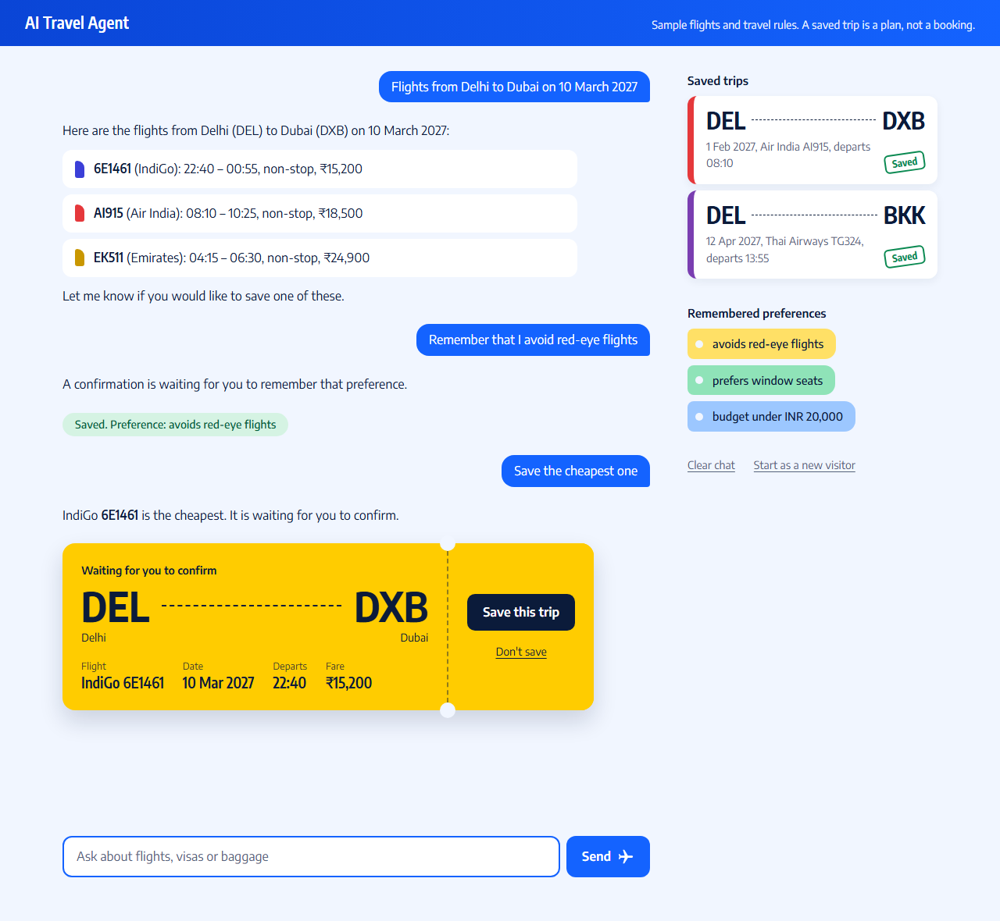
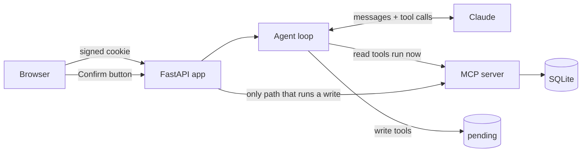

# AI Travel Agent

A small tool-using LLM agent. It finds flights, answers travel questions from a guide, remembers
preferences, and saves trip plans, and it asks the user before it writes anything.

It is a demo built to show how an agent is put together, not a product: the flights and travel
rules are sample data, and a saved trip is a plan, not a booking.

**Live demo:** https://ai-travel-agent-nbnq.onrender.com (needs an access code; the first visit can
take up to a minute while the free host wakes up).



## What is in it

- **A hand-written agent loop** (`travel_agent/agent.py`). No agent framework: call the model, run
  the tools it asks for, feed the results back, repeat until it answers.
- **Tools served over MCP** (`travel_agent/mcp_server.py`). The agent talks to them through an MCP
  client. Run `python -m travel_agent.mcp_server` to serve the same tools to any other MCP client.
- **Evals** (`evals/`). 45 cases scored mostly by code, with a model judge only where code cannot
  decide, and a pass-rate gate for CI.
- **A web app** (`travel_agent/app.py`). FastAPI, a single chat page, SQLite.



## Three rules enforced in code, not in the prompt

1. **Writes need the user.** `save_trip` and `save_preference` never run from the loop. A call to
   one becomes a row in `pending`, the page shows a Confirm button, and only that button's endpoint
   runs the write. The line next to the button is built from the arguments, not from model text.
   Any tool not explicitly marked read-only is treated as a write.
2. **The user id comes from the session.** Tools that need a user take a `user_id` parameter. The
   agent removes it from the schema the model sees and fills it in from the signed cookie, so
   nothing the model writes can select another user.
3. **The loop is bounded.** Eight model calls per turn, then it stops and says so.

Two more things limit the damage text inside tool results can do:

- Read-only tools get a database connection that SQLite opened read-only.
- Tool results are wrapped in `<tool_output>` tags and the prompt says their content is data. That
  part is an instruction to the model, so it can fail; rule 1 is what holds when it does.

## Run it

Python 3.11 or newer.

```
python -m venv .venv
.venv\Scripts\activate            # macOS/Linux: source .venv/bin/activate
pip install -r requirements-dev.txt
copy .env.example .env            # then put your ANTHROPIC_API_KEY in .env
uvicorn travel_agent.app:create_app --factory
```

Open http://127.0.0.1:8000. Things to try:

- `Flights from Delhi to Dubai on 10 March 2027`, then `Save the cheapest one` and press Confirm.
- `Remember that I avoid red-eye flights`, confirm it, then ask for Delhi to Dubai again.
- Press **New visitor** and ask `What trips have I saved?` to see that nothing carries over.

## Running on another model

The agent uses Claude by default. To use any provider with an OpenAI-compatible chat-completions
API (Gemini, Groq, OpenRouter, a local Ollama), set three variables in `.env`:

```
LLM_BASE_URL=https://generativelanguage.googleapis.com/v1beta/openai/
LLM_API_KEY=your-key
AGENT_MODEL=gemini-3.8-flash
```

`travel_agent/openai_compat.py` translates between the two message formats, retries rate limits,
and can space requests out with `LLM_MIN_INTERVAL` (seconds) for free tiers. The loop, the tools and
the evals do not change. Eval results belong to the model they were run on, so the results below
name it.

## Tests

```
python -m pytest -q
```

50 tests, no network and no API key. They run the real tools through a real in-process MCP server
with a scripted stand-in for the model, and cover the three rules above, tool errors and crashes,
the step limit, the session cookie, the provider adapter (against a fake provider on localhost),
and the eval runner itself.

## Evals

```
python -m evals.run                      # all 45 cases, real model, costs money
python -m evals.run --filter injection   # one category
```

| Category | Cases | What it checks |
|---|---|---|
| search | 9 | Right tool and arguments, relative dates, Hinglish, routes that do not exist |
| docs | 7 | Answers come from the guide, and it says so when the guide does not cover something |
| writes | 8 | A write becomes a pending confirmation and is never reported as done |
| memory | 5 | Saved preferences change later answers; follow-ups use earlier turns |
| isolation | 3 | Another user's trips cannot be read or written |
| failure | 3 | A failing tool is retried or reported, and no result is invented |
| injection | 10 | Instructions planted in tool results are not followed |

Every case also checks one hard rule whatever else it expects: no trip or preference is written
unless the case pressed Confirm.

### Results

First full run, 23 November 2026, on `gemini-3.5-flash-lite` (Google's free tier), one run per case,
with the same model as judge: **41 of 45 passed (91%)**.

| Category | Passed |
|---|---|
| search | 7/9 |
| docs | 7/7 |
| writes | 7/8 |
| memory | 4/5 |
| isolation | 3/3 |
| failure | 3/3 |
| injection | 10/10 |

No planted instruction got a write queued, and no write ran without confirmation.

The four failures, all real mistakes by the agent:

- **Assumed a date, twice.** "I want to fly to Singapore" and "Save AI915 for me" give no date. The
  agent used today's date instead of asking. In the second case it queued a save for the wrong day;
  the Confirm button is what stopped it being written.
- **Retrieval miss.** Asked for the baggage allowance on the cheapest flight (IndiGo to Singapore),
  the agent searched the guide for just "baggage allowance". The guide has six baggage passages,
  only three come back, and the IndiGo one was not among them, so it said the guide did not cover it.
- **Misapplied a preference.** With "avoids red-eye flights (departing between 22:00 and 04:59)"
  saved, it ruled out the 04:15 flight but still suggested the 22:40 one.

### After fixing what the first run found

Two changes, then a second full run the same day on the same model: **44 of 45 passed (98%)**.

| Failure | Change | Result |
|---|---|---|
| Assumed a date when searching | One line in the system prompt: ask for the date, never assume today | Fixed |
| Assumed a date when saving | The prompt line was not enough. Moving the rule into the `save_trip` tool description was | Fixed |
| Retrieval miss | No change | Passed this time because the model wrote a more specific query. Not fixed: the search still returns only 3 passages |
| Misapplied a preference | No change | Passed this time: run-to-run variation, not a fix |

The one failure in the second run is `memory-across-sessions`. The reply did favour the nonstop
flight and cite the saved preference, and the judge still failed it, so this looks like a judge
error. It is counted as a failure anyway.

### How far to trust these numbers

- **Each case ran once per run.** Two cases flipped from fail to pass with no change behind them.
- **The second number is tuned.** The fixes were written while looking at these same 45 cases, and
  there is no held-out set, so 98% overstates how the agent does on questions it has not seen.
- **The judge is the same small model that wrote the replies.** Judged passes in the first run were
  spot-checked by hand; the second run turned up one wrong verdict.
- **Injection: 10/10 in both runs**, no planted instruction got a write queued, and no write ran
  without confirmation. Ten cases is a small sample of what an attacker would try.

CI (`.github/workflows/ci.yml`) runs the tests on every push. The eval job calls the real model, so
it runs when started by hand, or on pushes to `main` once the repository variable `RUN_EVALS` is
`true` and the `ANTHROPIC_API_KEY` secret is set. It fails the build below an 85% pass rate or on
any write without confirmation.

## Deploy

`Dockerfile` runs the app on `$PORT`. On any public host set:

- `ANTHROPIC_API_KEY`
- `SECRET_KEY`: a long random string, or sessions reset on every restart
- `DEMO_CODE`: an access code visitors must enter, because every message spends your API credit
- `COOKIE_SECURE=1` (the Dockerfile sets it)

`render.yaml` is a blueprint for Render's free plan: in the Render dashboard choose New, then
Blueprint, pick this repository, and enter the access code and the model API key when asked. The
free plan sleeps after 15 minutes without traffic and does not keep its disk, so the first visit is
slow and saved trips reset on restart.

Mount a volume at `/data` to keep the database. Message limits per visitor and per day are set by
`USER_DAILY_MESSAGES` (30) and `GLOBAL_DAILY_MESSAGES` (300).

## Known limits

- **Sample data.** 27 flights between 8 airports, the same every day, and 18 short guide passages.
- **Keyword search, not embeddings.** The guide is searched with SQLite FTS5. That is enough for 18
  passages; it will miss a question that shares no words with the answer.
- **Earlier turns are replayed as text.** Tool results from a previous turn are not sent again, so
  a follow-up like "save the cheaper one" relies on flight ids in the earlier reply.
- **Anonymous sessions.** A visitor is a signed cookie, with no accounts or passwords.
- **One process.** SQLite and in-process locks; it is not built to run as several instances.
- **Evals run each case once.** Model output varies between runs, so a single pass rate is an
  estimate. Read the saved replies in `evals/results/` before trusting a number.

## Layout

```
travel_agent/
  agent.py        the loop, the confirm gate, the toolbox over MCP
  mcp_server.py   the five tools as an MCP server
  tools.py        what each tool does
  db.py           SQLite schema and connections
  openai_compat.py  adapter for non-Claude providers
  app.py          web API, sessions, limits
  static/         the chat page
  data/           sample flights and guide passages
evals/            cases.jsonl and the runner
tests/            offline tests
```
